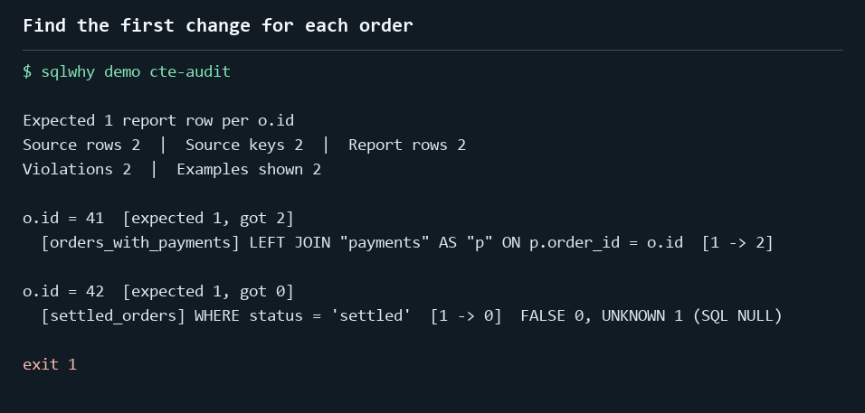

# sqlwhy

**Which step of your SQL report lost an order?** Give sqlwhy the query, its source key, and the number of rows you expect per key. It finds missing or duplicated keys and names the CTE and clause where their counts changed.

```sh
sqlwhy demo cte-audit
```

Two orders go in and two rows come out. The audit finds both problems:

```text
o.id = 41  [expected 1, got 2]
  [orders_with_payments] LEFT JOIN "payments" AS "p" ON p.order_id = o.id  [1 -> 2]
o.id = 42  [expected 1, got 0]
  [settled_orders] WHERE status = 'settled'  [1 -> 0]  FALSE 0, UNKNOWN 1 (SQL NULL)
```

This built-in example takes no files and intentionally exits **1**. Add `--json` for the complete trace.



## Try it

From a checkout, using Python 3.11 or later in a virtual environment:

```sh
python -m pip install .
cd examples/audit
sqlwhy audit cte_broken.sql --table orders=orders.csv --table payments=payments.csv --key o.id --expect-rows 1
sqlwhy audit cte_report.sql --table orders=orders.csv --table payments=payments.csv --key o.id --expect-rows 1
```

The report should include each order, even if it is awaiting payment. The first audit exits **1**. Order 41 matches two payments at the join. Order 42 survives the left join, then the filter drops it because its payment status is SQL NULL. The repaired report joins directly to the primary payment and keeps unpaid orders. The second audit exits **0**. [Broken SQL](examples/audit/cte_broken.sql) · [Repaired SQL](examples/audit/cte_report.sql)

## Audit your own query

### Compare saved report outputs

When a pull request changes a report, compare the base and candidate outputs built from the same input snapshot. The two inputs can be DuckDB tables or views, or named CSV or Parquet files. From the checkout root, this example reports two changed keys despite equal totals:

```sh
sqlwhy diff old new --table old=examples/orders.csv --table new=examples/payments_fanout.csv --key id --after-key order_id
```

Order 41 gains a row and order 42 disappears. Use `--db warehouse.duckdb` for database relations, `--limit 0` for totals, and `--json` for CI. Exit 1 means at least one key changed multiplicity. Exit 0 means every key had the same number of rows, and exit 2 means the comparison could not run. NULL forms one key. Text keys are compared by exact UTF-8 bytes and both key columns must have the same supported DuckDB type. Use audit or trace on a supported source query when you need to locate the responsible clause.

### Check a required count

```sh
sqlwhy audit report.sql --db warehouse.duckdb --key o.id --expect-rows 1
```

Choose a column from the leftmost source table and include it directly in the SELECT list with a unique output name. A column alias is fine. The rule applies once per distinct source key. For example, if the source contains three rows with the same ID and all three survive, that ID produces three report rows. All NULL keys form one group. A key with no surviving rows counts as zero. An empty source has zero keys to check. Pick the expectation that fits your report. A paid-orders-only report can deliberately omit an unpaid order.

The CLI counts every violation in one database snapshot. By default it explains up to five failing keys in ascending order, with NULL first. `--limit 0` returns the totals only. `--json` includes the totals and every trace stage for the displayed examples. Exit **0** means every key met the expectation, **1** means at least one violated it, and **2** means the audit could not run.

Audit keys can be booleans, fixed-width integers, decimals, floating-point numbers, strings, blobs, or UUIDs. Temporal and nested key types are unsupported. Columns of those types can still appear elsewhere in a report.

To use this check in GitHub Actions after installing sqlwhy, add a step like the one exercised by this repository. Change the query, files, and key to match your report. [CI workflow](.github/workflows/test.yml)

```yaml
- name: Require one report row per order
  working-directory: examples/audit
  run: sqlwhy audit cte_report.sql --table orders=orders.csv --table payments=payments.csv --key o.id --expect-rows 1
```

For measured timings, fixture size, hardware, and a command to repeat the run, see the [audit benchmark](benchmarks/README.md).

## Trace your own query

If you already know the ID, trace it directly. Run these examples from the checkout root, or run `sqlwhy demo flat-counts` anywhere after installing.

```sh
sqlwhy examples/report.sql --table orders=examples/orders.csv --table payments=examples/payments.csv --trace o.id=42
sqlwhy report.sql --db warehouse.duckdb --trace orders.id=42 --json
```

`--db` opens an existing DuckDB file read-only. Alternatively, repeat `--table name=path` to import individual local CSV or Parquet files into memory for this invocation. CSV uses DuckDB type inference. Parquet retains its stored types. File mode loads the supplied tables each time, so a DuckDB file is more convenient for repeated traces on larger data.

Use an unqualified source key or qualify it with the alias of the left table. An unambiguous base-table name also works. Bare `NULL` traces SQL NULL. Leading-zero IDs such as `0042` stay text. DuckDB casts the supplied value to the type of the source column.

The key belongs to the **leftmost source**. A key can identify several rows, and a join can multiply them. The counts are for all rows carrying that key. A WHERE stage reports separate TRUE, FALSE and UNKNOWN counts and example predicate inputs. An explanation identifies what the SQL did; deciding whether the query or the underlying data needs to change is up to the analyst.

DuckDB can skip a conversion inside `AND`, `OR`, `BETWEEN`, or `IN`. For example, `valid AND CAST(amount AS INTEGER) > 0` can discard an invalid record before reading its amount. When a guarded operation could fail, sqlwhy runs the native filter, reports its exact before/after counts, and marks discarded rows `UNCLASSIFIED`. The JSON uses `null` for the unavailable FALSE/UNKNOWN breakdown and omits samples for that filter.

### Keep a regression check

```sh
sqlwhy examples/report.sql --table orders=examples/orders.csv --table payments=examples/payments.csv --trace o.id=41 --expect-rows 1
```

That command exits **0**. Change the payments file to `examples/payments_fanout.csv` and the same check exits **1** with `Expected row count 1, got 2.` Add `--json` to capture the trace on stdout while the mismatch goes to stderr.

On a single-key trace, `--expect-rows N` checks the exact output count for the supplied value. Zero is valid. Use `--expect present|removed|source_absent` to check status, or combine both flags to check both. For example, `--expect removed --expect-rows 0` also requires that the key existed in the source. Without an expectation, a completed trace exits **0**. Invalid input and unsupported SQL exit **2**.

## Python API

```python
from pathlib import Path

import duckdb
from sqlwhy import audit_rows, trace_row

with duckdb.connect("warehouse.duckdb", read_only=True) as con:
    sql = Path("report.sql").read_text()
    con.execute("BEGIN TRANSACTION READ ONLY")
    audit = audit_rows(con, sql, "orders.id", expected_rows=1, limit=3)
    print(audit["violation_count"])
    result = trace_row(con, sql, "orders.id", 42)
    print(result["status"], result["output_rows"])
    con.commit()
```

## Scope

Both audit and single-key trace support plain DuckDB SELECTs and linear, nonrecursive `WITH` chains. The first CTE reads a source table or view. Each subsequent step reads its predecessor. Each SELECT may add one INNER or LEFT equijoin to a lookup table or view and a row-level WHERE. Specify the key as it appears at the original source. Each step must carry it forward directly under a unique output name, including through a rename such as `o.id AS order_id`. JSON stages in a chain carry a `cte` field, with `null` for the outer SELECT.

Branches, grouping, window functions, DISTINCT, ORDER BY, LIMIT, and arbitrary SQL functions remain outside this release. If a named step drops the key or changes the grain through aggregation, the CLI identifies the unsupported step and exits **2**. Displayed stages follow logical SQL order. For compound conditions, the evidence describes the whole predicate.

Use `WITH step AS (SELECT id AS order_id ...)` to rename a key inside the projection. CTE column lists such as `step(order_id) AS (...)` and materialization hints such as `AS MATERIALIZED` are unsupported. When a projection alias also names a source column, qualify that column in the filter, for example `SELECT id AS id FROM orders WHERE orders.id IS NOT NULL`.

DuckDB can push a later filter ahead of an earlier cast. A complete report may therefore succeed even if evaluating that earlier CTE on its own raises a conversion error. When a selected example encounters this, sqlwhy reports the CTE and the error. Use `audit --limit 0` to get the native report totals without evaluating intermediate examples.

The trace measures row survival before projection. It does not evaluate the SELECT list for runtime conversion errors. Use deterministic source relations: repeated reads of a volatile view can produce different rows. The command is intended for trusted analytical queries and local inputs. The Python API uses the connection supplied by its caller. Trace output may include source values, so review it before attaching it to an issue.

## What happened on real SQL fixes?

MIT Open Learning fixed a blank discussion chart after finding that two tables used different names for the same platform. On synthetic tables, sqlwhy traced the original report query unchanged and showed the target disappearing at its inner join. A second published example hit a real limit. DuckDB executed the Stash issue reporter's query, but its `SELECT DISTINCT` prevents sqlwhy from tracing it.

We selected ten public fixes involving missing or duplicated rows. Isolating the affected joins and filters made all ten pre-fix examples traceable. Two repaired examples still use unsupported query forms. Each case records the source, the reductions made, and the observed counts. The study measures behavior on selected fixtures. It does not estimate coverage of arbitrary SQL. [Ten-case results and sources](research/results.md)

Run `python research/replay.py` to reproduce the original table offline. For v0.4, we tested compiled DuckDB SQL separately, including a Jaffle Shop staging model and a deliberately faulty variant. [dbt compilation and compatibility results](research/dbt/README.md)

## Development

```sh
python -m pip install -e ".[test]"
python -m pytest -q
```

MIT licensed.
